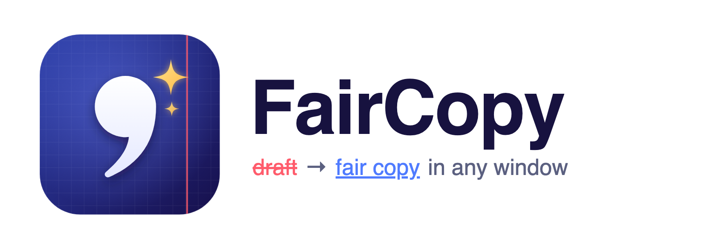
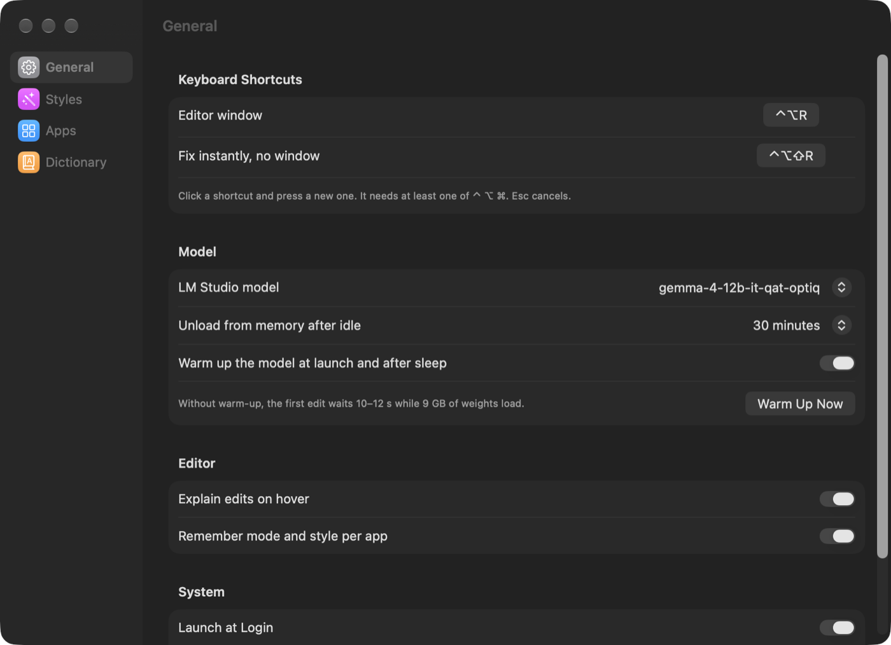

# FairCopy



**A private, offline AI editor for any text field on your Mac.** Select text (or just put the cursor in a message box), press <kbd>⌃⌥R</kbd> and get a clean copy — typos, punctuation and broken sentences fixed, while your casual tone, slang and emoji stay exactly as they were.

*Fair copy* is the clean version you write out after a rough draft. FairCopy does that for every message — inspired by Telegram's AI Editor, but it works in any app and runs entirely on your Mac through [LM Studio](https://lmstudio.ai). No cloud, no account, your text never leaves the machine.

[Русская версия](README.ru.md)

<p align="center">
  
</p>

## Features

- **Fix** — spelling, punctuation, capitalization and run-on sentences. It does *not* make your text formal: "tmrw", "lol", swearing and emoji survive.
- **Restyle** — Formal, Short, Friendly, Polite, Corporate, Tribal, Zen, Biblical, Viking, **No Fillers** (drops "like / um / basically / you know") or any style you describe in your own words.
- **Translate** — into 10 languages, optionally with a style on top.
- **Edits you can read** — removed text in red, added text in blue; hover over an edit to see the rule behind it.
- **Edit before applying** — tweak the result by hand, then <kbd>⌘↩</kbd>.
- **Instant fix** — <kbd>⌃⌥⇧R</kbd> replaces the text in place, no window.
- **Per-app memory** — Telegram can open in *Short*, Mail in *Formal*; FairCopy remembers what you used where.
- **Style editor** — edit, reorder, delete or add styles (instruction + before→after examples), test them right in Settings; built-in styles can be restored anytime.
- **My Voice** — build a style from your own messages (pasted text or a Telegram Desktop export, HTML or JSON). FairCopy studies how you write and then rewrites any text the way *you* would say it.
- **Personal dictionary** — names and terms the model must never "correct".
- **Model warm-up / unload** from the menu bar: keep the model hot, or free ~9 GB of memory.
- Liquid Glass UI, English and Russian interface; prompts follow the interface language.

<p align="center">
  
</p>

## Requirements

- macOS 26 or later, Apple Silicon (tested on an M4 with 24 GB)
- [LM Studio](https://lmstudio.ai) with its local server
- A model — the default is **Gemma 4 12B** (MLX, 4-bit QAT, ~9 GB). Anything OpenAI-compatible works; Qwen 3.5 9B is a lighter alternative.
- Xcode Command Line Tools (full Xcode is not needed)

## Download

[](https://github.com/LoginPro/faircopy-mac/releases/latest)

Grab the **.dmg** from the [latest release](https://github.com/LoginPro/faircopy-mac/releases/latest), open it and drag FairCopy to Applications. FairCopy isn't notarized, so on first launch macOS blocks it once: open **System Settings → Privacy & Security** and click **Open Anyway**. Then follow steps 1–2 below and get a model:

```bash
~/.lmstudio/bin/lms get https://huggingface.co/mlx-community/gemma-4-12B-it-qat-OptiQ-4bit
```

## Build from source

```bash
# 1. Get the model (LM Studio's CLI is installed with the app)
~/.lmstudio/bin/lms get https://huggingface.co/mlx-community/gemma-4-12B-it-qat-OptiQ-4bit

# 2. Build and install FairCopy to ~/Applications
git clone https://github.com/LoginPro/faircopy-mac.git
cd faircopy-mac
./build.sh install
```

Then:

1. **Accessibility.** System Settings → Privacy & Security → Accessibility → enable *FairCopy*. It is needed to read the selected text and paste the result back.
2. **LM Studio token** (only if your LM Studio server requires authentication): LM Studio → Developer → Server Settings → Manage Tokens → Create Token, then FairCopy menu → *LM Studio Token…*. It is stored in your Keychain.

FairCopy starts the LM Studio server by itself when it isn't running.

### Code signing

`build.sh` signs the app with a local code-signing certificate named `AI Editor Local Signing` if you have one, and ad-hoc otherwise. With ad-hoc signing macOS treats every rebuild as a new app, so you'll have to re-enable Accessibility after each build. To avoid that, create a self-signed certificate once (Keychain Access → Certificate Assistant → Create a Certificate…, type *Code Signing*) and pass its name:

```bash
SIGN_ID="My Code Signing" ./build.sh install
```

## Usage

| Shortcut | Action |
|---|---|
| <kbd>⌃⌥R</kbd> | Open the editor for the selection (or the whole field if nothing is selected) |
| <kbd>⌃⌥⇧R</kbd> | Fix instantly and replace, no window |
| <kbd>↩</kbd> / <kbd>⌘↩</kbd> | Apply (⌘↩ while editing the result) |
| <kbd>⌘R</kbd> | Try again |
| <kbd>esc</kbd> | Close |

Shortcuts can be changed in Settings → General.

## How it works

- **Text in, text out.** FairCopy reads the selection through the Accessibility API (falling back to <kbd>⌘C</kbd>), sends it to LM Studio on `127.0.0.1`, and pastes the result with <kbd>⌘V</kbd>, restoring your clipboard afterwards.
- **Prompts that keep your voice.** Few-shot examples teach the model to fix only mistakes and leave slang alone. Thinking mode is turned off for speed.
- **My Voice** doesn't fine-tune anything. FairCopy measures formal habits in code (capitalization, periods, emoji, length), asks the model to describe your wording and tone, keeps only expressions that really recur in your messages, and turns a few of your messages into *neutral → your version* examples by back-translation.
- All prompts and the built-in styles live in [`shared/`](shared/) as JSON, not in the code, so a port to another OS uses exactly the same wording. `--dump-prompts` prints every assembled prompt to check that a port matches.
- Your styles live in `~/Library/Application Support/FairCopy/styles.json`.

## Command line

The app binary doubles as a CLI, handy for testing prompts and models:

```bash
APP="build/FairCopy.app/Contents/MacOS/AIEditor"
"$APP" "hey so i was thinking maybe we could grab lunch tmrw"   # fix
"$APP" --explain "its been raining all day"                     # fix + explain each edit
"$APP" --style "No Fillers" "so like um i basically finished it"
"$APP" --translate English "привет, как дела?"
"$APP" --voice ~/Downloads/ChatExport "Text to rewrite in my voice"
"$APP" --warm | --cool | --model-state                          # model memory
"$APP" --dump-prompts                                           # print all prompts as sent to the model
AIEDITOR_URL=http://127.0.0.1:8080/v1 "$APP" "…"                # any OpenAI-compatible server
```

## Project layout

```
Sources/      Swift sources (AppKit + SwiftUI, built with swiftc — no Xcode project)
shared/       prompts and built-in styles as JSON — shared with future ports (see shared/README.md)
Resources/    Info.plist, icons, en/ru localizations
Branding/     logo and icon sources (SVG), DMG background and layout
build.sh      build, sign and install
release.sh    build the installer DMG (needs `pip install dmgbuild`); `./release.sh publish` makes a GitHub release
```

Code comments are in Russian — the project started as a personal tool.

## License

[MIT](LICENSE)
