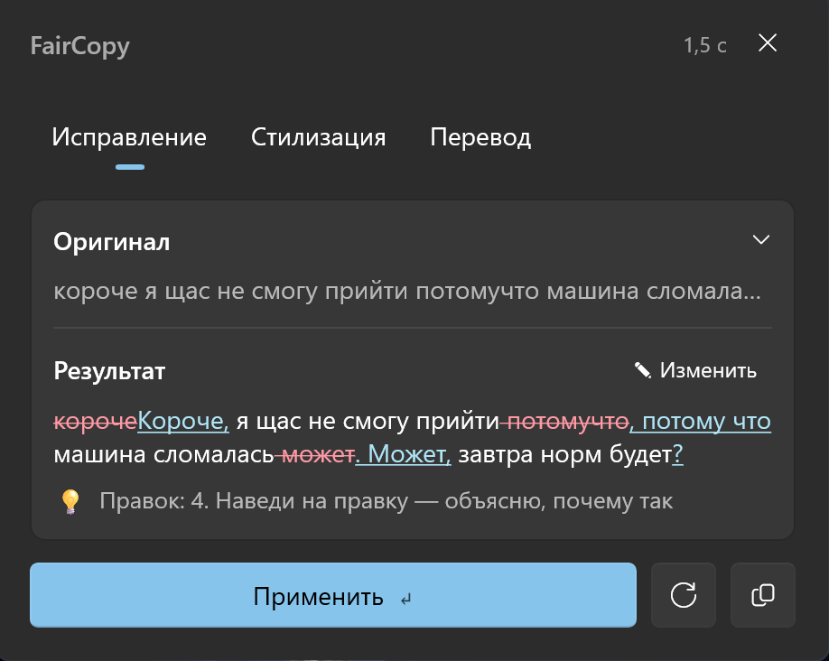

# FairCopy для Windows

**Офлайн ИИ-редактор для любого поля ввода в Windows.** Выдели текст (или просто поставь курсор в поле сообщения), нажми <kbd>Ctrl</kbd>+<kbd>Alt</kbd>+<kbd>R</kbd> — и получи чистовик: опечатки, пунктуация и корявые фразы исправлены, а разговорный тон, сленг и эмодзи остались на месте.

Это порт [FairCopy для Mac](https://github.com/LoginPro/faircopy-mac). Всё работает на твоём компьютере через [LM Studio](https://lmstudio.ai): без облака и аккаунтов, текст никуда не уходит.

[English version](README.md)

> **В разработке.** Исправление, стилизация, перевод и мгновенная правка работают; окна настроек (редактор стилей, словарь, приложения, хоткеи, «Мой стиль») пока нет — настройки лежат в `%APPDATA%\FairCopy\settings.json`. Установщика пока нет: собирать из исходников.

<p align="center">
  
</p>

## Что умеет

- **Исправление** — орфография, пунктуация, заглавные буквы, слитный поток слов. Текст *не* становится официальным: «щас», «норм», мат и эмодзи остаются.
- **Стилизация** — Без паразитов, Официальный, Краткий, Дружеский, Вежливый, Корпоративный, Племенной, Дзен, Библейский, Викинг или свой стиль, описанный словами.
- **Перевод** — на 10 языков, можно со стилем поверх.
- **Понятные правки** — удалённое красным, добавленное подчёркнуто; наведи на правку — увидишь правило.
- **Ручная правка** результата перед применением — потом <kbd>Ctrl</kbd>+<kbd>Enter</kbd>.
- **Мгновенная правка** — <kbd>Ctrl</kbd>+<kbd>Alt</kbd>+<kbd>Shift</kbd>+<kbd>R</kbd> заменяет текст на месте, без окна.
- **Память по приложениям** — режим и стиль, применённые в приложении, открываются там в следующий раз.
- Живёт в трее: прогрев и выгрузка модели, выбор модели, запуск при входе.
- Буфер обмена возвращается после каждого захвата и вставки, а временный текст FairCopy не попадает в журнал буфера (<kbd>Win</kbd>+<kbd>V</kbd>).
- Русский и английский; промпты и стандартные стили общие с Mac-версией (`shared/`) и сверяются с ней байт в байт.

## Что нужно

- Windows 10 1809 и новее / Windows 11, x64
- [LM Studio](https://lmstudio.ai) с локальным сервером
- Модель — проверено на **Gemma 4 26B-A4B QAT** (GGUF, Q4_0, ~14,4 ГБ; влезает в видеокарту на 16 ГБ). Подойдёт любой OpenAI-совместимый сервер; Gemma 4 12B — вариант полегче.
- [.NET 10 SDK](https://dotnet.microsoft.com/download) для сборки

## Сборка и запуск

```powershell
git clone https://github.com/LoginPro/faircopy-windows.git
cd faircopy-windows
dotnet build FairCopyWin.slnx
.\src\FairCopy.App\bin\Debug\net10.0-windows10.0.19041.0\win-x64\FairCopy.exe
```

Загрузи модель в LM Studio (или FairCopy сам поднимет сервер через `lms server start`). Если сервер LM Studio требует API-токен, пока задай его в переменной окружения `LM_API_TOKEN`.

## Как это работает

1. Глобальное сочетание клавиш (`RegisterHotKey`) срабатывает в приложении, где ты пишешь.
2. FairCopy читает выделение через UI Automation; если приложение его не отдаёт — жмёт <kbd>Ctrl</kbd>+<kbd>C</kbd>, а если ничего не выделено — <kbd>Ctrl</kbd>+<kbd>A</kbd>, <kbd>Ctrl</kbd>+<kbd>C</kbd> (буфер обмена сохраняется и возвращается).
3. Текст уходит локальной модели вместе с примерами, которые держат твой тон.
4. **Применить** вставляет результат обратно через <kbd>Ctrl</kbd>+<kbd>V</kbd>.

Windows не даёт обычной программе слать нажатия в программу, запущенную от администратора, поэтому в таких окнах захват и вставка не работают.

## Устройство

| Путь | Что |
|---|---|
| `src/FairCopy.Core` | промпты, стили, «Мой стиль», пословный дифф, клиент LM Studio, настройки — без интерфейса, собирается и на macOS |
| `src/FairCopy.Platform` | Win32: хоткеи, значок в трее, буфер обмена, `SendInput`, UI Automation, Диспетчер учётных данных |
| `src/FairCopy.App` | приложение на WinUI 3 (без MSIX): трей и окно редактора |
| `src/FairCopy.Cli` | `faircopy-cli --dump-prompts`, `models`, `fix …` — проверка ядра из терминала |
| `shared/` | промпты и стандартные стили, копия из Mac-репозитория |
| `tests/reference/` | вывод `--dump-prompts` Mac-версии; вывод Windows-версии должен совпадать байт в байт |

## Лицензия

MIT
