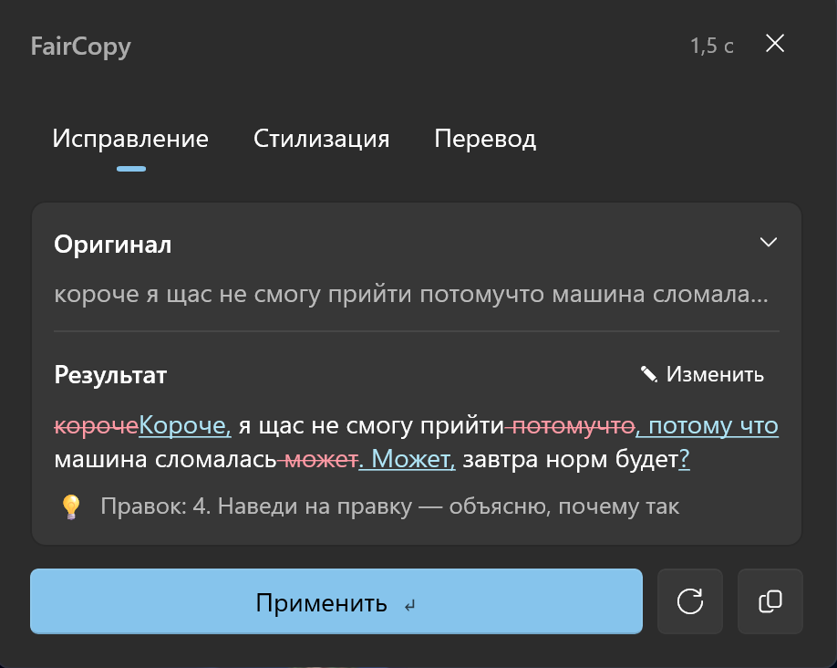

# FairCopy for Windows

**A private, offline AI editor for any text field on Windows.** Select text (or just put the cursor in a message box), press <kbd>Ctrl</kbd>+<kbd>Alt</kbd>+<kbd>R</kbd> and get a clean copy — typos, punctuation and broken sentences fixed, while your casual tone, slang and emoji stay exactly as they were.

This is the Windows port of [FairCopy for Mac](../README.md). It runs entirely on your PC through [LM Studio](https://lmstudio.ai): no cloud, no account, your text never leaves the machine.

[Русская версия](README.ru.md)

> **Work in progress.** Fix, restyle, translate and instant fix work; the Settings window (style editor, dictionary, per-app list, hotkeys, My Voice) is not ported yet — settings live in `%APPDATA%\FairCopy\settings.json` for now. There is no installer yet: build from source.

<p align="center">
  
</p>

## Features

- **Fix** — spelling, punctuation, capitalization and run-on sentences. It does *not* make your text formal: "tmrw", "lol", swearing and emoji survive.
- **Restyle** — Formal, Short, Friendly, Polite, Corporate, Tribal, Zen, Biblical, Viking, No Fillers or a style you describe in your own words.
- **Translate** — into 10 languages, optionally with a style on top.
- **Edits you can read** — removed text in red, added text underlined; hover over an edit to see the rule behind it.
- **Edit before applying** — tweak the result by hand, then <kbd>Ctrl</kbd>+<kbd>Enter</kbd>.
- **Instant fix** — <kbd>Ctrl</kbd>+<kbd>Alt</kbd>+<kbd>Shift</kbd>+<kbd>R</kbd> replaces the text in place, no window.
- **Per-app memory** — the mode and style you applied in an app are used there next time.
- Lives in the notification area: model warm-up / unload, model picker, start at login.
- Your clipboard is restored after every grab and paste, and FairCopy's temporary text is kept out of clipboard history (<kbd>Win</kbd>+<kbd>V</kbd>).
- English and Russian; prompts and built-in styles are shared with the Mac app (`../shared/`) and checked byte for byte against it.

## Requirements

- Windows 10 1809 or later / Windows 11, x64
- [LM Studio](https://lmstudio.ai) with its local server
- A model — tested with **Gemma 4 26B-A4B QAT** (GGUF, Q4_0, ~14.4 GB; fits a 16 GB GPU). Anything OpenAI-compatible works; Gemma 4 12B is a lighter alternative.
- [.NET 10 SDK](https://dotnet.microsoft.com/download) to build

## Build and run

```powershell
git clone https://github.com/LoginPro/faircopy.git
cd faircopy\windows
dotnet build FairCopy.slnx
.\src\FairCopy.App\bin\Debug\net10.0-windows10.0.19041.0\win-x64\FairCopy.exe
```

Load a model in LM Studio (or let FairCopy start the server with `lms server start`). If the LM Studio server requires an API token, set the `LM_API_TOKEN` environment variable for now.

## How it works

1. A global hotkey (`RegisterHotKey`) fires in the app you're typing in.
2. FairCopy reads the selection through UI Automation; if the app doesn't expose it, it sends <kbd>Ctrl</kbd>+<kbd>C</kbd>, and if nothing is selected — <kbd>Ctrl</kbd>+<kbd>A</kbd>, <kbd>Ctrl</kbd>+<kbd>C</kbd> (the clipboard is saved and restored).
3. The text goes to the local model with few-shot examples that keep your tone.
4. **Apply** pastes the result back with <kbd>Ctrl</kbd>+<kbd>V</kbd>.

Windows does not let a normal app send keystrokes to an app running as administrator, so grabbing and pasting don't work in elevated windows.

## Project layout

| Path | What |
|---|---|
| `src/FairCopy.Core` | prompts, styles, My Voice, word diff, LM Studio client, settings — no UI, also builds on macOS |
| `src/FairCopy.Platform` | Win32: hotkeys, tray icon, clipboard, `SendInput`, UI Automation, Credential Manager |
| `src/FairCopy.App` | WinUI 3 app (unpackaged): tray controller and editor window |
| `src/FairCopy.Cli` | `faircopy-cli --dump-prompts`, `models`, `fix …` — checks the core from a terminal |
| `../shared/` | prompts and built-in styles, shared with the Mac app |
| `tests/reference/` | `--dump-prompts` output of the Mac app; the Windows output must match it byte for byte |

## License

MIT — see [LICENSE](../LICENSE).
